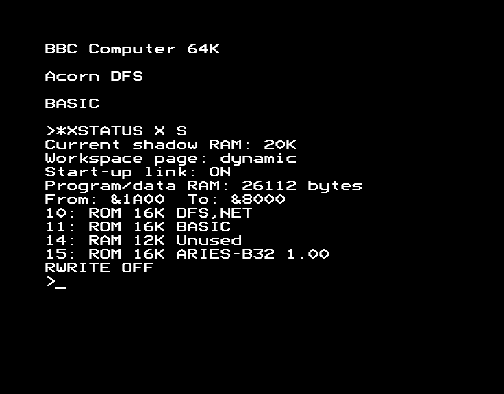
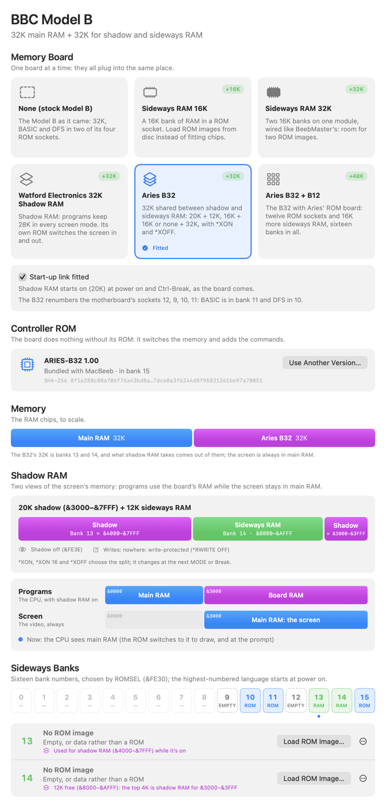
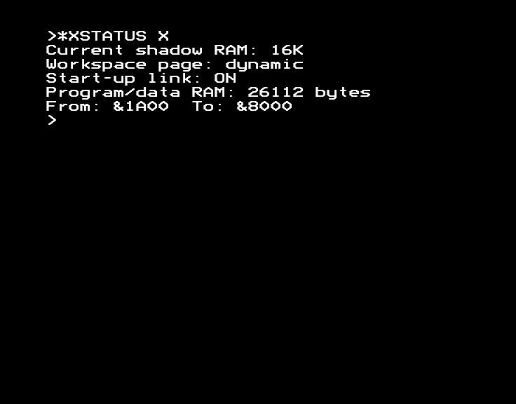
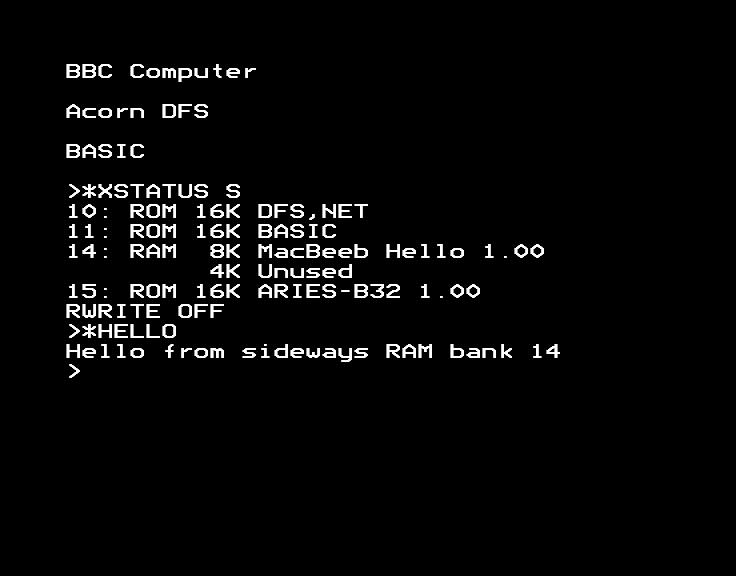
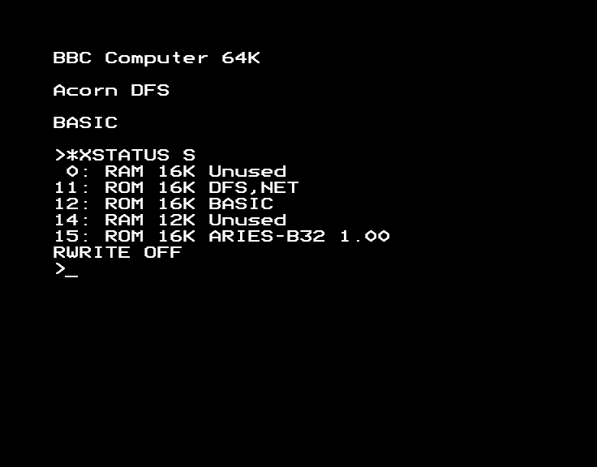
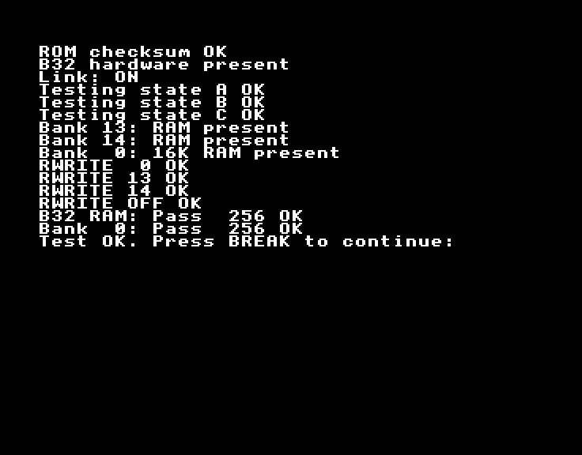

# Aries B32 and B12

The Aries B32 adds 32K of RAM to the Model B. You choose how to divide it
between **shadow RAM** (programs keep their memory in every screen mode)
and **sideways RAM** (for ROM images and data):

| Shadow RAM | Sideways RAM | Command |
| --- | --- | --- |
| 20K (&3000–&7FFF) | 12K in bank 14 | `*XON` (the default) |
| 16K (&4000–&7FFF) | 16K in bank 14 | `*XON 16` |
| None | 32K in banks 13 and 14 | `*XOFF` |

It's one pool of 32K, divided up, not 20K plus 32K. The Aries B12 adds twelve
ROM sockets and 16K more sideways RAM. Together they fill all sixteen banks.

## Quick start

1. **Machine ▸ Hardware Expansions…** (⌥⌘E), click **Aries B32** (or
   **Aries B32 + B12**), then **Restart BBC**.
2. The BBC says "BBC Computer 64K". Type `*XSTATUS X S` to see the board.



## What it does

The B32 plugs into the 6502's socket and has its own ROM, **ARIES-B32 1.00**,
in its socket (bank 15). The ROM adds the commands (`*XON`, `*XOFF`,
`*XSTATUS`, `*RLOAD`, `*RWRITE`, `*XTEST` and others) and switches the
shadow RAM in and out as the OS draws on the screen.

Its 32K is sideways banks 13 and 14. Shadow RAM is taken from them: first all
of bank 13 (for &4000–&7FFF), then, for 20K, the top 4K of bank 14 (for
&3000–&3FFF). The Hardware Expansions window shows the split as the BBC runs:



**The banks are renumbered.** Without the B12, the B32 makes the BBC's four
ROM sockets banks 12, 9, 10 and 11 (left to right), so BASIC is in bank 11
and the DFS in bank 10. With the B12, the BBC's sockets hold the B12's cable,
and its manual says to move the ROMs to its sockets 9 to 12 in the same
order: BASIC in 12 and the DFS in 11. Bank 0 is the B12's RAM.

| Bank | B32 alone | B32 + B12 |
| --- | --- | --- |
| 0 | — | B12 RAM, 16K |
| 1–8 | — | B12 sockets |
| 9–12 | BBC's sockets (DFS in 10, BASIC in 11) | B12 sockets (DFS in 11, BASIC in 12) |
| 13, 14 | B32 RAM, shared with shadow RAM | B32 RAM, shared with shadow RAM |
| 15 | B32's socket: ARIES-B32 1.00 | The same |

## Enable it in MacBeeb

1. Choose **Machine ▸ Hardware Expansions…**. If the BBC isn't a Model B,
   click **Switch to a Model B**.
2. Click **Aries B32**, or **Aries B32 + B12**.
3. **Start-up link fitted** is on, as the board comes: shadow RAM is on at
   power on and after Ctrl-Break. Turn it off to start with shadow RAM off.
   `*XSTATUS` reports the link.
4. **Controller ROM** shows ARIES-B32 1.00, bundled. You don't need to find
   one.
5. Click **Restart BBC**.

## First example: shadow RAM

At power on there's 20K of shadow RAM, so even MODE 1 or 2 leaves BASIC
26112 bytes, from &1A00 to &8000. `*XSTATUS` shows it. For a program that
needs it, try `Examples/shadow-ram/shadow.bas` from the
[Watford guide](watford-shadow-ram.md): it runs here too.

## Changing the split: *XON 16 and *XOFF

`*XON 16` asks for 16K of shadow RAM. Nothing changes yet:

```
*XON 16
*XSTATUS
```

says "Current shadow RAM: 20K" and "Pending shadow RAM: 16K". The change
happens at the next `MODE` (even to the same mode) or Break:

```
MODE 7
*XSTATUS X
```



16K is enough for screen modes 3 to 7. In MODE 1 (20K) the extra 4K comes out
of your program's space: `*XSTATUS` then shows 22016 bytes, from &1A00 to
&7000, as the manual says. `*XON` (or `*XON 20`) goes back to 20K at the next
MODE.

`*XOFF` turns shadow RAM off completely. It says "B32: Press BREAK to
continue:" and waits. After Break, MODE 1 leaves 5888 bytes (&1900 to &3000),
as on a Model B without the board. `*XON` turns it back on, again after Break.

`*XOFF 2` turns shadow RAM off at the next MODE without a Break, keeping the
ROM's workspace, so your program stays where it is (MODE 7: 25088 bytes, from
&1A00 to &7C00). `*XOFF 1` is the same, except the ROM gives up using its
workspace, for games that overwrite it.

| What you do | Shadow RAM |
| --- | --- |
| `*XON`, `*XON 16`, `*XOFF 1`, `*XOFF 2` | Changes at the next MODE or Break (`*XSTATUS` shows it as pending) |
| `*XOFF`, or `*XON` from off | Changes after the Break it asks for |
| Break | Keeps the current setting |
| Ctrl-Break | 20K again if the start-up link is fitted (as much as it can without overwriting sideways RAM in use); off without the link |
| Power Cycle | As Ctrl-Break, with the RAM cleared |

## Sideways RAM: *RLOAD and *RWRITE

`*RLOAD` loads a ROM image file into a bank of B32 or B12 RAM. With
`Examples/sideways-ram/hello-rom.ssd` in drive 0 (**File ▸ Insert Disc in
Drive 0…**):

```
*RLOAD HELLO 14
```

The ROM reminds you the OS won't see the new ROM until Break. Press Break,
then:

```
*XSTATUS S
*HELLO
```



With 20K of shadow RAM bank 14 has 12K, so a 16K image won't fit: use
`*XON 16` (and MODE 7) first.

Unlike most sideways RAM, the B32's RAM is **write-protected** until you say
otherwise. `*RWRITE 14` sends every write to &8000–&BFFF to bank 14, whichever
bank is being read: BASIC can still run from bank 11 while it writes into
bank 14. `*RWRITE OFF` protects it again. `*RWRITE 0` writes to the B12's RAM,
and `*RWRITE EXTERNAL` to sideways RAM on other boards. Ctrl-Break, `*XON` and
`*XOFF` set it back to OFF.

You can also use the Hardware Expansions window to load an image into bank
13, 14 or (with the B12) 0 from the Mac: **Load ROM Image…** beside the bank.
The window shows how much of banks 13 and 14 shadow RAM is using. Loading over
it while shadow RAM is on corrupts the program in shadow RAM.

## The B12

With **Aries B32 + B12**, bank 0 is 16K of RAM and banks 1 to 12 are ROM
sockets:



## Testing the board: *XTEST

`*XTEST` is the ROM's own full test of the hardware: every shadow RAM
arrangement, every bank, write-protection and a 256-pass RAM test. It takes a
few minutes, as on the real board (turn on **Full Speed**, ⌥⌘F, to hurry it).
It should end with "Test OK":



Press Break afterwards, as it asks.

## How to undo it

Choose **None (stock Model B)** in the Hardware Expansions window and click
**Restart BBC**. To run a game that won't work with shadow RAM, `*XOFF` and
Break is enough.

## Troubleshooting

- **"B32: Not enough RAM"** from `*RLOAD`: bank 14 has 12K with 20K of shadow
  RAM. `*XON 16`, MODE 7, then try again.
- **"B32: RAM in use"** from `*XON 20`: the top 4K of bank 14 holds a ROM
  image. `*XON` takes as much as it can (16K) instead.
- **Writing to &8000 from BASIC does nothing**: the RAM is write-protected.
  `*RWRITE 14` first.
- **A game crashes or shows garbage**: `*XOFF` and Break, then load it.
- **"Bad sum" from ADFS after `*XON` or `*XOFF`**: the manual's fix is to put
  ADFS in a higher bank than the B32's ROM. MacBeeb's Aries setup doesn't
  include ADFS.

## What is and isn't emulated

MacBeeb's B32 was worked out from what the real ROM writes to the board and
what its own `*XTEST` expects, then checked against the manual's examples.
The ROM's `*XTEST` passes, and `*XSTATUS` reports the manual's figures.

- **Registers** (all written by the ROM, none read): &FE30 ROMSEL; &FE32 the
  bank writes go to (13 or 14 the B32's RAM, 15 nowhere, 0–12 passed on to the
  BBC); &FE3F and &FE3E shadow RAM on and off; &FE3A and &FE3C shadow
  &3000–&3FFF on and off; &FE36 and &FE34 shadow &7000–&7FFF on and off;
  &FE38 sets shadow RAM as the start-up link says. MAME emulates only some of
  these.
- **The pool**: shadow &4000–&7FFF is bank 13, and &3000–&3FFF is the top 4K of
  bank 14 (&B000–&BFFF). The screen is always in the BBC's own RAM.
- **The B12**: its RAM takes every write passed on from the B32 (the B12's
  manual calls this write-through), so `*RWRITE 0` reaches it and `*RWRITE
  OFF` protects it.
- **Not emulated**: other Aries boards (the B20), a RAM chip in the B32's ROM
  socket, the B12 without a B32, and other sideways RAM boards alongside it
  (`*RWRITE EXTERNAL` has nothing to write to).
- MAME calls this ROM "v2.2". Its own header, and the manual's examples, say
  1.00.

## References

- *ARIES-B32: 32K RAM expansion for the BBC Microcomputer Model B* (manual),
  and *ARIES-B12* (manual), at chrisacorns.computinghistory.org.uk.
- MAME, `src/devices/bus/bbc/internal/aries.cpp`.
- ARIES-B32 1.00, (C)1985 David Barnett & Chris Jordan: SHA-256
  `8f1e288c08a706f76a43bd8ae296bfb7dce0a3f6244d8f95831261be97a78051`.
- `docs/development/expansion-hardware-notes.md`: how the registers were
  worked out.
