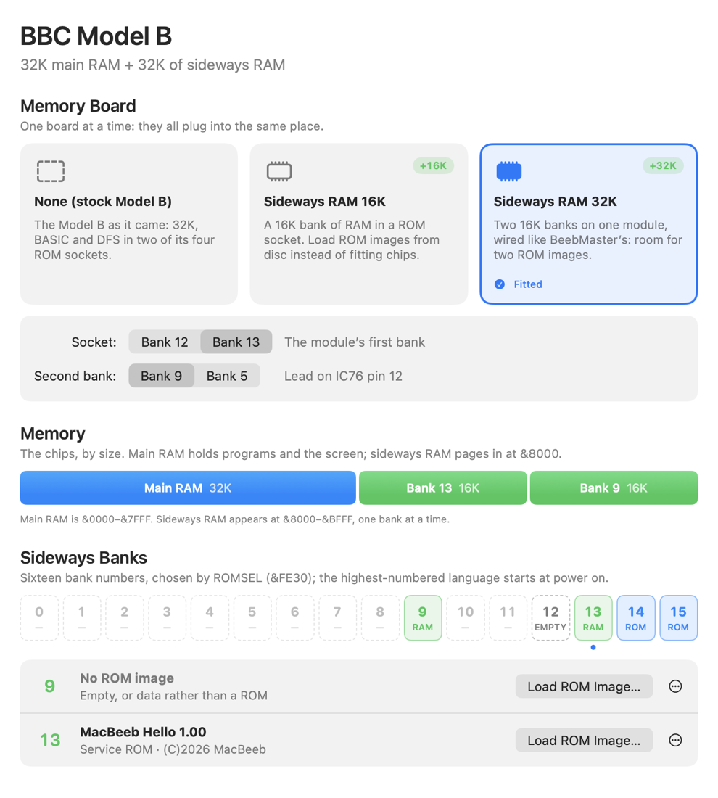
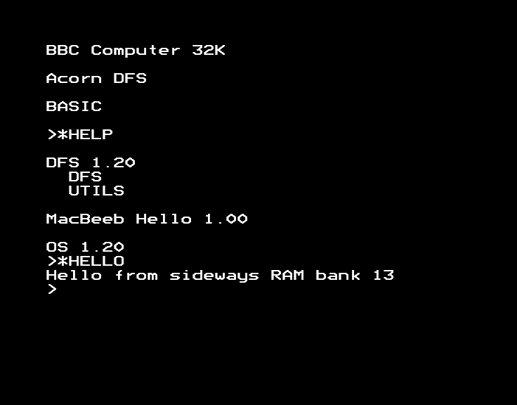
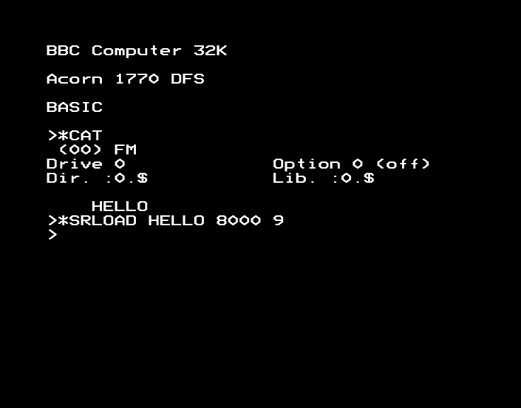
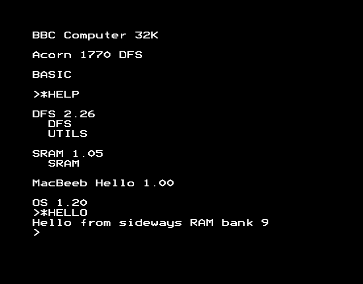

# Sideways RAM

Sideways RAM is a bank of RAM where a ROM chip would go. Load a ROM image
into it and, after a Break, the BBC uses it just like the chip: no
screwdriver needed. It can also hold data, such as a printer buffer or a
game's levels.

## Quick start

1. **Machine ▸ Hardware Expansions…** (⌥⌘E), click **Sideways RAM 32K**,
   then **Restart BBC**.
2. Under **Sideways Banks**, click **Load ROM Image…** beside bank 13 and
   choose a ROM image (a `.rom` file, up to 16K).
3. Press **Break** (⌘B). Type `*HELP`: your ROM is listed.

To try it with a ROM made for this guide, use `Examples/sideways-ram/hello.rom`
from MacBeeb's source, as below.

## What it does

The Model B has four ROM sockets, banks 12 to 15. BASIC is in bank 15 and
the disc filing system in bank 14, leaving 12 and 13 free. A sideways RAM
module plugs into a free socket:

- **Sideways RAM 16K**: one bank, the socket's.
- **Sideways RAM 32K**: two banks. MacBeeb follows BeebMaster's 32K module:
  the first bank is the socket's, and a flying lead to IC76 (the chip that
  holds ROMSEL) makes a second bank, four below the first (lead on pin 12) or
  eight below (pin 11).



The bank strip shows all sixteen banks. Green banks are RAM, blue ones are
ROM, and dashed ones are empty sockets or nothing at all. The dot under a
bank shows the one ROMSEL has selected as the BBC runs. It's mostly BASIC's,
15.

## Enable it in MacBeeb

1. Choose **Machine ▸ Hardware Expansions…**. If the BBC isn't a Model B,
   click **Switch to a Model B**.
2. Under **Memory Board**, click **Sideways RAM 16K** or **Sideways RAM 32K**.
3. Choose where it goes:
   - **Socket**: **Bank 12** or **Bank 13**, the module's first bank.
   - **Second bank** (32K only): four or eight below the first, for example
     bank 9 or bank 5 with the module in bank 13.
4. Click **Restart BBC**.

The window's title bar then says, for example, "BBC Model B + Sideways RAM
32K".

## First example: a ROM image from the Mac

`Examples/sideways-ram/hello.rom` is a tiny service ROM: it adds a line to
`*HELP` and a command, `*HELLO`, that says which bank it's running in. Its
source, `hello-rom.asm`, is beside it.

1. With a sideways RAM board fitted, click **Load ROM Image…** beside bank 13
   in the Hardware Expansions window, and choose `hello.rom`.
2. Press **Break** (⌘B).
3. Type:

   ```
   *HELP
   *HELLO
   ```



The OS checks every bank for a ROM when you press Break, so a plain Break is
enough. Ctrl-Break (⌃⌘B) works too.

To have an image in a bank every time the BBC starts, choose **Load an Image
at Power On…** from the bank's **⋯** menu. It's loaded at each power cycle;
**Start Empty at Power On** stops it.

## Second example: loading it from the BBC

Loading from the Mac is a convenience. A real BBC loaded sideways RAM itself,
and MacBeeb's sideways RAM is written the same way: the BBC selects the bank
in ROMSEL and stores into &8000 to &BFFF.

Acorn's 1770 DFS (version 2.26) has sideways RAM commands built in. Use it to
load the example ROM from disc:

1. Choose **Machine ▸ Disc Interface ▸ Acorn 1770 (DFS 2.26)**. The BBC
   restarts, still with the board fitted.
2. Open `Examples/sideways-ram/hello-rom.ssd` with **File ▸ Insert Disc in
   Drive 0…**.
3. Type:

   ```
   *SRLOAD HELLO 8000 9
   ```

   This loads the file `HELLO` into bank 9 (the 32K module's second bank in
   bank 13) at its start, &8000.

   

4. Press **Ctrl-Break** (⌃⌘B), then type `*HELP` and `*HELLO`.

   

`*HELP SRAM` lists DFS 2.26's other sideways RAM commands: `*SRSAVE` to save
a bank to disc, `*SRWRITE` and `*SRREAD` to copy memory in and out, and
`*SRROM` and `*SRDATA` to mark a bank as a ROM or data.

## Save, clear and replace

Each RAM bank in the Hardware Expansions window has a **⋯** menu:

- **Save Contents…** saves the bank's 16K to a file on the Mac.
- **Clear…** empties it (all zeros, as at power on). It asks first. A ROM
  image there disappears at the next Break.
- **Load ROM Image…** replaces whatever's there. An image shorter than 16K
  replaces only the start of the bank.

## Volatile and power-on contents

Sideways RAM keeps its contents through Break and Ctrl-Break, but not
through a power cycle (⇧⌘R): switching off empties RAM. Power-on images are
loaded afresh each time. Save states keep the RAM exactly as it was.

## How to undo it

Choose **None (stock Model B)** in the Hardware Expansions window and click
**Restart BBC**. The Model B is then exactly as before, with its ROMs in banks
14 and 15.

## Physical and logical views

The BBC sees one bank at a time at &8000 to &BFFF: the CPU's **logical**
view. MacBeeb can also look at any bank **physically**, without paging it in:

- The Hardware Expansions window shows each bank's ROM title.
- The debugger's memory view has a space for each bank.
- AI agents use `peek` with `space: "bank13"` for the bank itself, or
  `space: "host"` for what the CPU sees now (usually BASIC).

## Troubleshooting

- **"Bank 15 isn't sideways RAM"**: only RAM banks can be loaded. The bank
  strip shows which are green.
- **The ROM isn't in `*HELP`**: press Break after loading. If it's still
  missing, the image may not be a ROM. The bank's row says "No ROM image" when
  there's no valid ROM header (the copyright string must be where byte 7 of
  the image says).
- **`*SRLOAD` says "Bad command"**: the 8271's DFS 1.20 doesn't have it.
  Choose **Machine ▸ Disc Interface ▸ Acorn 1770 (DFS 2.26)**.
- **A language ROM doesn't start**: at power on the OS starts the language
  in the highest-numbered bank, BASIC in 15. Start yours with its own command,
  such as `*FORTH`.
- **Writable in MacBeeb but not for some software**: these modules are
  written whenever their bank is selected, as BeebMaster's is. Some boards had
  a write-protect switch or a separate write register, and software written
  for one of those may expect it.

## What is and isn't emulated

- 16K and 32K modules in banks 12 or 13, with the 32K module's second bank
  four or eight below, as BeebMaster documents.
- Writes go to the RAM whenever its bank is selected in ROMSEL; ROM and empty
  sockets ignore writes.
- On a real Model B, banks 0 to 11 also reach the motherboard sockets (only
  part of ROMSEL is decoded), so a module answers to more than one number.
  MacBeeb gives each bank one number, as a ROM board does.
- Banks 14 and 15 hold DFS and BASIC, so the module can't go there.

## References

- BeebMaster, *BBC Model B 32K Sideways RAM Module Fitting Instructions*
  (version 1.1, 2010): the bank wiring and the IC76 lead.
- Acorn DFS 2.26's SRAM 1.05 commands (`*HELP SRAM`).
- The [developer reference](developer-reference.md), for the memory map and
  the MCP tools.
