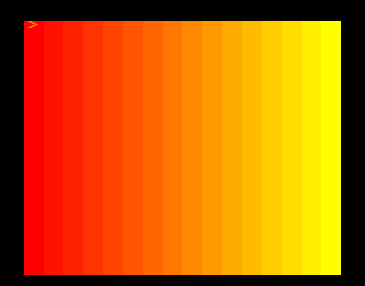
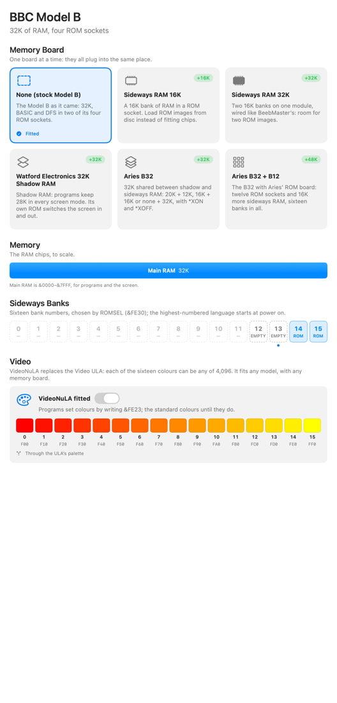
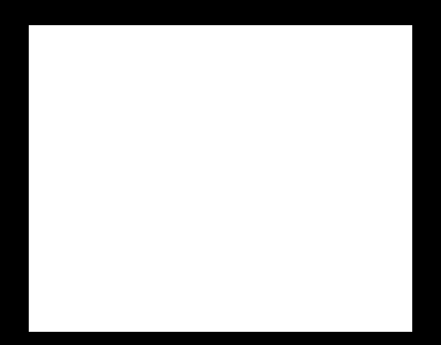

# VideoNuLA

VideoNuLA is RobC's replacement for the BBC Micro's Video ULA, the chip that
turns screen memory into colours. The stock ULA has eight colours (and
eight flashing ones). With VideoNuLA, each of the sixteen colours can be any
of **4,096**, chosen by the program. MODE 2 still has 16 colours on screen at
once and 160×256 pixels; they're just far better colours.

## Quick start

1. **Machine ▸ Hardware…** (⌥⌘E). Under **Video**, turn on
   **VideoNuLA fitted**, then click **Restart BBC**.
2. Paste `Examples/videonula/ramp.bas` (**Edit ▸ Paste Text**, ⌘V) and
   type `RUN`.



## What it does

A program sets a colour by writing two bytes to &FE23:

| Byte | Bits 7–4 | Bits 3–0 |
| --- | --- | --- |
| First | the colour (0–15) | red (0–15) |
| Second | green (0–15) | blue (0–15) |

So colour 8 as orange (red 15, green 8, blue 0) is `?&FE23=&8F:?&FE23=&80`.
The colour shows on screen at once, wherever colour 8 is used. Changes made
part way down the screen show from that line down. The ordinary palette
(&FE21, `VDU 19`) still chooses which colour each logical colour uses.

&FE22 is NuLA's control register: the top four bits pick a function and the
bottom four are its value. `?&FE22=&40` puts the standard colours back.

VideoNuLA works on any model: Model A or B, B+, Master 128 or Compact. It
doesn't change screen modes, timing or memory, and it works alongside any
memory board.

## Enable it in MacBeeb

1. Choose **Machine ▸ Hardware…**.
2. Under **Video**, turn on **VideoNuLA fitted**. It's off by default.
3. Click **Restart BBC**. The window's title bar then ends "+ VideoNuLA".

While the BBC runs, the window shows NuLA's sixteen colours as the program
sets them, with their RGB444 values, which colours flash, and the palette
mode.



## First example: a colour ramp

`Examples/videonula/ramp.bas`:

```
10 REM VideoNuLA: sixteen shades from red to yellow
20 MODE 2
30 VDU 23,1,0;0;0;0;
40 FOR C%=0 TO 15
50 GCOL 0,C%:X%=C%*80
60 MOVE X%,0:MOVE X%,1023:PLOT 85,X%+79,0:PLOT 85,X%+79,1023
70 NEXT
80 REM Colour C%: red 15, green C%, blue 0
90 FOR C%=0 TO 15
100 ?&FE23=C%*16+15
110 ?&FE23=C%*16
120 NEXT
130 REM ?&FE22=&40 puts the standard colours back
```

Lines 40 to 70 draw sixteen bars, one per colour. Lines 90 to 120 give colour
*n* full red and green *n*: from red (colour 0) to yellow (colour 15), through
orange, which is colour 8 (`F80`, `#FF8800`).

**To put the colours back:** `?&FE22=&40`, or change MODE and run it again
without lines 90 to 120.

**On a stock BBC** (VideoNuLA not fitted), &FE23 is just &FE21 again: the same
writes go to the ordinary palette and turn every bar white. That's what a real
Model B does with this program:



## The gallery demos

The **Bitshifters VideoNuLA Gallery** (github.com/bitshifters/bbc-nula, three
discs, `bbcnula1.ssd` to `bbcnula3.ssd`) shows 16-colour MODE 2 pictures with
palettes chosen from all 4,096 colours. Download a disc, open it with **File
▸ Open Disc…** (it boots), and watch the slide show.

Without VideoNuLA the gallery still runs, but its palette writes land in the
ordinary palette, as on a real stock BBC, and the colours are wrong.

## Control functions

| `?&FE22=` | Function | Emulated |
| --- | --- | --- |
| `&10` / `&11` | Palette through the ULA (normal) / direct: logical colours pick NuLA's colours straight | Yes |
| `&20`–`&27` | Shift the picture right 0–7 pixels | Yes |
| `&30`–`&3F` | Blank 0–15 columns at the left | Yes |
| `&40` | Reset: standard colours, no shift or blanking | Yes |
| `&50` | Disable NuLA until power off (&FE22/&FE23 act as &FE20/&FE21) | Yes |
| `&60` / `&61` | Attribute mode off / on | Yes (mode 1, as b2 emulates it) |
| `&62`, `&63` | Other attribute modes | No: drawn as mode 0 |
| `&70`, `&71` | Text attribute mode | No |
| `&8x`, `&9x` | Which of colours 8–11 (`&8x`) and 12–15 (`&9x`) flash: one bit each | Yes |
| `&Ex`, `&Fx` | Border and blank colours | No: ignored |

Programming a colour stops it flashing. In MODE 7 the teletext colours are
NuLA's colours 0 to 7.

## How to undo it

Turn off **VideoNuLA fitted** and click **Restart BBC**. To undo a program's
colours without taking NuLA out, use `?&FE22=&40`.

## Using VideoNuLA through MCP

AI agents can fit, program and check VideoNuLA with MacBeeb's MCP tools.
Writes go through the BBC's own I/O decoding, so they behave exactly like a
program's.

1. **Discover**: `get_hardware` has a line `video: the stock Video ULA` (or
   `VideoNuLA …`). `video_nula` gives the full state and capabilities.
2. **Fit it** (a restart): `power_cycle {"video_nula": true}`.
3. **Draw something**, e.g. with `run_command` and the MODE 2 bars above.
4. **Program a colour**, either through the real register:
   `bus_write {"address": "&FE23", "bytes": [143, 128]}` (`&8F`, `&80`),
   or with the helper, which makes the same two writes:
   `set_video_nula_palette {"index": 8, "rgb": "F80"}`.
5. **Check the state**: `video_nula` shows ` 8: &F80 (#FF8800)`, and each
   logical colour's mapping and the colour its pixels show now.
6. **Check the screen**: `screenshot`. Bar 8 is `#FF8800`.
7. **Controls**: `set_video_nula_control {"function": 2, "value": 3}` (shift 3
   pixels), `{"function": 4}` (reset), and so on.

Errors say what's wrong: `not_fitted:` (no NuLA), `disabled:` (the BBC turned
it off with function 5), `invalid_value:` (an index outside 0–15, or a colour
that isn't 3 hex digits), `pending_write:` (a program has written the first
byte of a colour but not the second) and `unsupported_feature:` (functions that
aren't emulated). The [developer reference](developer-reference.md) has the
details.

## Troubleshooting

- **Colours don't change**: is VideoNuLA fitted? The window title says
  "+ VideoNuLA". Did the program disable it (`&50`)? That lasts until a power
  cycle.
- **One colour is wrong, the rest are fine**: the two writes to &FE23 must come
  in pairs. If a program wrote an odd number, the next byte completes the
  wrong colour. `?&FE22=&40` resets it.
- **Everything flashes**: colours 8–15 flash until they're programmed or their
  flash bits are cleared (`?&FE22=&80`, `?&FE22=&90`).

## What is and isn't emulated

MacBeeb's VideoNuLA is a port of b2's. b2's own NuLA picture tests pass
pixel for pixel: every pixel rate, clock and flash setting with the palette
through the ULA and direct, attribute mode 1, and every horizontal offset and
left blanking setting in screen modes 0 to 8 (368 pictures). The stock Video
ULA's 16 pictures match too, and a machine without NuLA is unchanged.

- Emulated: the 12-bit palette and its two-byte protocol, direct palette mode,
  offset, left blanking, reset, disable, attribute mode 1, the flash bits, and
  MODE 7's colours.
- Not emulated: attribute modes 2 and 3, the text attribute mode, and the
  border and blank colours (E and F). No reference shows how they look; b2
  doesn't draw them, and jsbeeb stubs E and F too. They're accepted and do
  nothing, rather than guessed.
- b2's pictures are b2's own output, not photographs of real hardware, so
  matching them shows MacBeeb agrees with b2.

## References

- VideoNuLA by RobC (Stardot forums).
- b2 by Tom Seddon (`VideoULA.cpp`, and the tests in `etc/b2_tests/5`).
- jsbeeb (`video.js`), and B-Em.
- The Bitshifters VideoNuLA Gallery by Simon Morris (github.com/bitshifters/bbc-nula).
