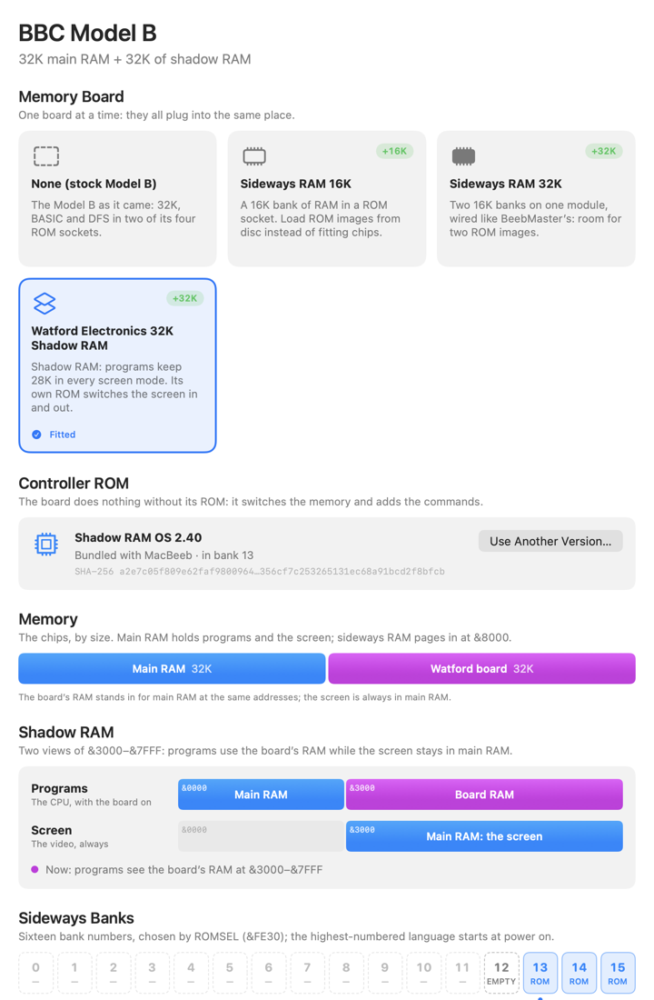
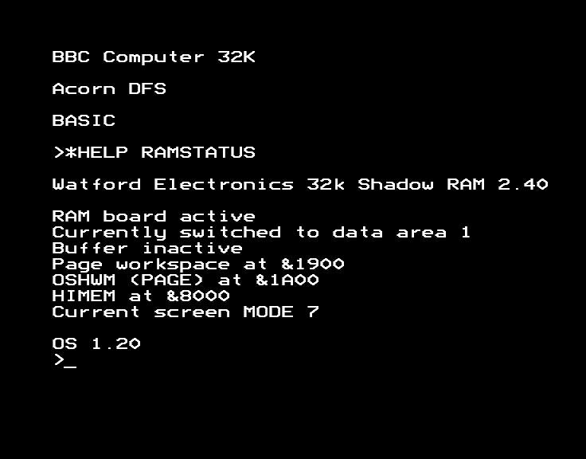
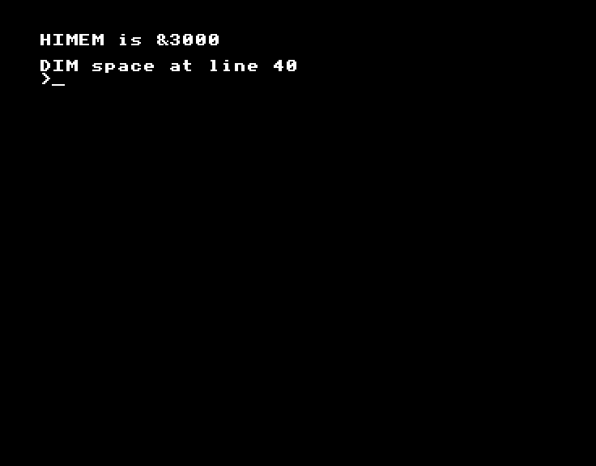
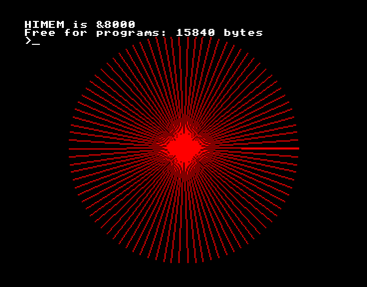

# Watford Electronics 32K Shadow RAM

Watford Electronics' 32K RAM board doubles the Model B's memory. Its main
use is **shadow RAM**: programs keep about 28K in every screen mode, even
the 20K graphics modes, because the screen and the program live in
different RAM at the same addresses.

## Quick start

1. **Machine ▸ Hardware Expansions…** (⌥⌘E), click **Watford Electronics 32K
   Shadow RAM**, then **Restart BBC**.
2. Type `MODE 1`, then `PRINT ~HIMEM`. It says `8000`. On a stock Model B
   it's `3000`.
3. Type `*HELP RAMSTATUS` to see the board's state.

## What it does

A Model B in MODE 0, 1 or 2 uses &3000 to &7FFF, 20K, for the screen. With
the disc system, that leaves under 6K for a BASIC program.

The board has 32K of its own RAM. It can stand in for the BBC's at
&3000–&7FFF (or at all of &0000–&7FFF). The video circuitry always reads the
BBC's own RAM, so:

- **Programs** see the board's RAM at &3000–&7FFF: room for code and data.
- **The screen** is still in the BBC's RAM at &3000–&7FFF.



The board's ROM, **Shadow RAM OS 2.40**, makes this work. It switches the
CPU to the BBC's RAM when the OS draws on the screen, then back to the
board's RAM for the program. The switch is a write to one of the top
addresses of memory:

| Write to | The CPU then sees at &0000–&7FFF |
| --- | --- |
| &FFFF | BBC RAM below &3000, the board's RAM from &3000 |
| &FFFE | BBC RAM (the screen) |
| &FFFC | The board's RAM throughout |

The Hardware Expansions window shows the latch as the BBC runs. While the
BBC waits at the prompt, the ROM leaves it on BBC RAM.

## Enable it in MacBeeb

1. Choose **Machine ▸ Hardware Expansions…**. If the BBC isn't a Model B,
   click **Switch to a Model B**.
2. Click **Watford Electronics 32K Shadow RAM**.
3. Under **Controller ROM**, MacBeeb shows the ROM it will use: Shadow RAM OS
   2.40, bundled, in bank 13. You don't need to find one.
4. Click **Restart BBC**.

The board is on from power on, as the manual says: `*HELP` lists "Watford
Electronics 32k Shadow RAM 2.40".



The ROM takes a page of workspace, so PAGE is &1A00 instead of &1900.

A sideways RAM module can go in too (under **In a ROM Socket**): the board's
ROM then goes in whichever of banks 12 and 13 the module doesn't take. See
[Sideways RAM](sideways-ram.md#with-a-shadow-ram-board).

## First example: a program too big for MODE 1

`Examples/shadow-ram/shadow.bas` sets MODE 1, makes a 10K array and draws on
the screen:

```
10 REM Needs more memory than MODE 1 leaves on a stock Model B
20 MODE 1
30 PRINT "HIMEM is &";~HIMEM
40 DIM P%(2500)
50 FOR I%=0 TO 2500:P%(I%)=I%*I%:NEXT
60 GCOL 0,1
70 FOR A=0 TO 2*PI STEP PI/45
80 MOVE 640,512:DRAW 640+460*COS(A),512+460*SIN(A)
90 NEXT
100 PRINT "Free for programs: ";HIMEM-TOP-4*2500;" bytes"
```

Type it in, or paste it with **Edit ▸ Paste Text** (⌘V), then `RUN`.

On a stock Model B it stops at line 40:



With the Watford board it runs. The array is in the board's RAM, and the
picture is in the BBC's:



## The board's own commands

`*HELP RAM` lists them. These have been tried in MacBeeb:

| Command | What it does |
| --- | --- |
| `*HELP RAMSTATUS` | The board's state: active or not, the data area, PAGE and HIMEM |
| `*RAMOFF` | Turns shadow RAM off at once. Change MODE (or press Break) for BASIC to see the usual HIMEM |
| `*RAMON` | Turns it back on. Press Break, as the ROM asks, so PAGE can move |
| `*FX34,1` / `*FX34,0` | Selects the board's RAM (data area 1) or the BBC's (data area 0) at &3000–&7FFF, for programs that want both |

The others (`*BUFFERON`, `*SSAVE`, `*SLOAD`, `*RAMEDIT` and more) are the
real ROM's, as the board's manual describes them.

## MODE, Break and resets

| What you do | The board |
| --- | --- |
| `MODE` | Stays on: HIMEM stays at &8000 |
| Break | Stays as it was (on or off), as the manual says |
| Ctrl-Break | **Off**, with no workspace: "usually necessary for games" (the manual). `*RAMON` then Break turns it on |
| Power Cycle | On again, its RAM cleared |

## How to undo it

Choose **None (stock Model B)** in the Hardware Expansions window and click
**Restart BBC**. For one game, Ctrl-Break turns the board off without
taking it out.

## Using your own ROM

To use a different version of the ROM, click **Use Another Version…** under
Controller ROM and choose your file. MacBeeb checks it against the versions
it knows (2.40, 2.20, 2.00, 1.06 and 1.00, by their hashes). It also accepts
a 16K dump that holds the 8K ROM twice. A file it doesn't recognise can be
used after a warning. **Use the Bundled ROM** goes back to 2.40. Either way,
the BBC restarts when you click **Restart BBC**.

## Troubleshooting

- **HIMEM is &3000 in MODE 1**: the board is off. Did you press Ctrl-Break?
  Type `*RAMON` and press Break.
- **A game crashes or shows garbage**: many games write straight to the
  screen and expect the stock memory layout. Press Ctrl-Break to turn the
  board off, then load the game.
- **A machine-code program's screen writes go missing**: they land in the
  board's RAM, not on the screen. Use the OS (VDU) to draw, `*FX34,0` around
  the writes, or turn the board off.
- **The picture looks wrong after a screen dump**: screen dumpers need the
  BBC's RAM. Use `*SSAVE`/`*SLOAD`, which switch it in.

## Physical and logical views

- The debugger and AI agents can read the board's RAM directly: memory space
  `board`, &0000–&7FFF. `main` is the BBC's own RAM, and `host` is what the
  CPU sees now.
- The debugger's Hardware view shows the latch, writes to &FFFD and the
  controller ROM.

## What is and isn't emulated

- The board's 32K is separate from the BBC's RAM. The latch is set by the
  address of a CPU write to &FFFC, &FFFE or &FFFF (the value doesn't matter),
  as MAME emulates it and the manual's "Direct control" section describes.
  The video always reads the BBC's RAM.
- Only the CPU's own writes move the latch. MacBeeb's peeks and pokes don't.
- **&FFFD**: the board decodes it too, but nothing documents what it does
  (MAME doesn't emulate it). MacBeeb ignores it and counts any writes in the
  debugger's Hardware view. Shadow RAM OS 2.40 hasn't been seen to use it.
- The manual suggests fitting the DFS in the lowest-priority socket and the
  board's ROM next to it. MacBeeb keeps the DFS in bank 14, as on its other
  Model Bs, with the board's ROM in 13. Both arrangements were tested: SAVE
  and LOAD of a program running past &3000 in MODE 1 work either way.
- Mark I boards' extra wires (CLK, REF, S19) and the external power supply
  option don't apply to an emulator.

## References

- *Watford Electronics 32K RAM Extension Board* manual (chrisacorns.computinghistory.org.uk): the
  commands, *FX34 and the "Direct control" addresses.
- MAME, `src/devices/bus/bbc/internal/we32kram.cpp`: the latch and the ROM
  versions' hashes.
- Shadow RAM OS 2.40, (C)1985 Ian Smith: SHA-256
  `a2e7c05f809e62faf980096459165fa356cf7c253265131ec68a91bcd2f8bfcb`.
